<!-- widths: 0.25 0.75 noheader -->
| Website | https://magellon.rcc.fsu.edu |
|---|---|
| Runs on | RCC GPU node f17-krios-gpu-13 (4 GPUs for MotionCor and CTF) |
| Your data | Read from the lab's research storage, /gpfs/research/stagg (never changed) |
| Magellon's storage | /gpfs/research/cryo_magellon/Magellon (20 TB, shared by everyone) |
| Questions | Ask a Magellon administrator in the lab |

[[toc]]

# 1. Magellon at a glance

Magellon turns a microscope session into something you can browse and analyse in a web browser. When you import a session, Magellon reads the images and movies from the lab's research storage, makes pictures and FFTs of every image, and sends the exposures to the GPU plugins for CTF estimation and motion correction (MotionCor). You can then browse the session from the atlas down to single exposures, check the results, and pick particles.

## The typical workflow

1. **Log in** at https://magellon.rcc.fsu.edu with the account an administrator made for you.
2. **Import** a session (Leginon, EPU or SerialEM) from the **Import** page.
3. **Watch the progress** in the progress window, the top-bar chip or the **Jobs** panel.
4. **Browse the results** on the **Images** page: pictures, FFT, CTF, frame alignment, metadata.
5. **Pick particles** by hand or automatically (Topaz or templates).
6. **Export** to RELION or CryoSPARC, or **delete** the session when you no longer need it.

## The screen

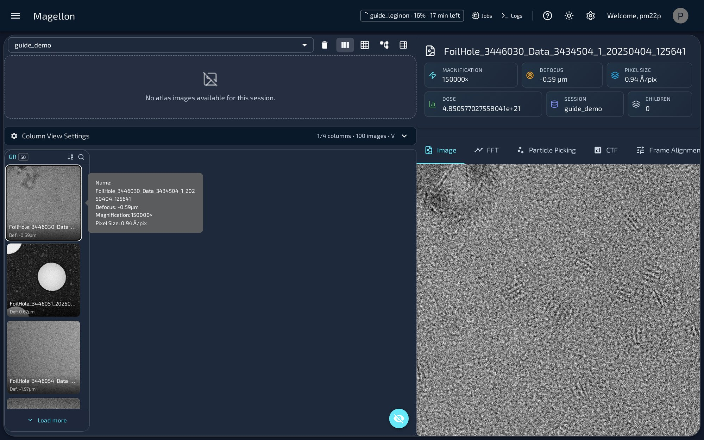

- **Menu** (three lines, top left) opens the navigation: Images, Jobs, Import, Export and, for administrators, Plugins, Security and Tools.
- **Import chips** appear in the top bar while imports run (see section 6).
- **Jobs** opens the Jobs panel on the right: everything running or finished recently.
- **Light/dark theme**: the sun or moon icon switches between them.

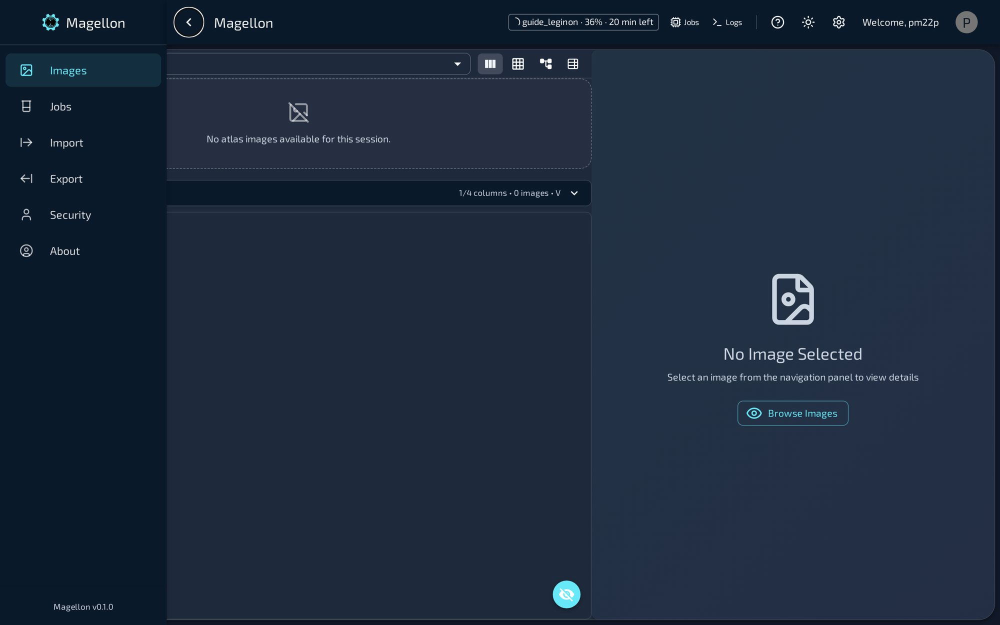

# 2. Accounts and roles

An administrator creates your account and gives it a role. A new account has no access until it has a role. When an administrator changes your role, the change applies straight away; you don't need to log out.

<!-- widths: 0.46 0.15 0.17 0.22 -->
|  | Viewer | Member | Administrator |
|---|---|---|---|
| See every session, its images and results | Yes | Yes | Yes |
| Import sessions (Import page) | No | Yes | Yes |
| Run single-file CTF / MotionCor jobs | No | Yes | Yes |
| Pick and save particles | No | Own sessions | Any session |
| Stop an import | No | Own imports | Any import |
| Delete a session | No | Own sessions | Any session |
| Change your own password | Yes | Yes | Yes |
| Manage users and roles (Security page) | No | No | Yes |
| Plugins, Pipeline Health, Ops Event Log, API docs | No | No | Yes |

The session you import is yours: you own it. Owners and administrators are the only people who can stop its import or delete it. If you are later changed to Viewer, you keep read access to the sessions you own.

> **Tip.** If the **Import** page is missing from your menu, your account is a Viewer. Ask an administrator to make you a Member.

## 2.1 The rules

These rules are built into Magellon; the website enforces them, so a button you aren't allowed to use is simply not shown.

<!-- widths: 0.34 0.66 -->
| Rule | Details |
|---|---|
| Every session has an owner | Whoever imports a session owns it. Ownership doesn't change if the owner's role changes. |
| Everyone with a role can see every session | Viewers, Members and Administrators can open any session, its images and results. Nothing is hidden between lab members. |
| Only Members and Administrators import | Viewers don't see the Import page or the Run Processing Jobs page. |
| One name, one session | A session name can be used once. Names in use by an existing session, or by an import that is waiting or running, are refused. |
| Owners and Administrators stop imports | A Member can stop only their own imports; an Administrator can stop anyone's. Stopping deletes everything the import created. |
| Owners and Administrators delete sessions | A Member can delete only sessions they own; an Administrator can delete any session. Viewers can't delete anything. |
| No deleting while importing | A session can't be deleted while its import is running or its CTF/MotionCor work is still going. Stop the import, or wait for it to finish. |
| Deleting needs the exact name | To delete, you type the session's name exactly. The Delete button stays grey until it matches. |
| Deleting is permanent | A deleted session can't be recovered from Magellon. It can be imported again from the original data. |
| A stopped import can't be resumed | Import the session again to start over. |
| Original data is never changed | Magellon only reads /gpfs/research/stagg. Stopping, deleting and clean-up never touch it. |
| At most 4 imports run at once | Others wait in the queue; turns are shared fairly between people. |
| Picks are changed only in your own sessions | Anyone can view a session's saved picks. Adding, changing or deleting picks is for the session's owner and Administrators; elsewhere the picking tools are view-only. |
| Picks belong to their session | Saved particle picks are kept with the session and deleted with it. |
| Finished jobs are listed for 30 days | Older jobs drop out of the Jobs panel; their results stay. |
| Roles are changed by Administrators only | On the Security page. The change applies at once. |

## 2.2 Everything Magellon can do

<!-- widths: 0.4 0.3 0.1 0.1 0.1 -->
| Feature | Where | Viewer | Member | Admin |
|---|---|---|---|---|
| Browse sessions, atlas and image columns | Images | Yes | Yes | Yes |
| View image, FFT, CTF, frame alignment, metadata | Images - image panel tabs | Yes | Yes | Yes |
| See everyone's jobs and their progress | Jobs (top bar) | Yes | Yes | Yes |
| Import Leginon / EPU / SerialEM / Magellon sessions | Import | - | Yes | Yes |
| Follow an import, run it in the background | Progress window, top-bar chips | - | Own | Yes |
| Withdraw a queued import | Progress window | - | Own | Any |
| Stop a running import (deletes what it made) | Progress window, Jobs | - | Own | Any |
| Delete a session | Images (bin icon), Jobs (bin icon) | - | Own | Any |
| View saved particle picks | Images - Particle Picking | Yes | Yes | Yes |
| Pick particles by hand and save them | Images - Particle Picking | - | Own | Any |
| Automatic picking (Topaz, templates), preview, batch | Particle Picking - Settings | - | Own | Any |
| Export picks (e.g. COCO) / import picks | Particle Picking - record menu | Export | Own | Any |
| Run MotionCor or CTF on a single file | Jobs (menu) - Run Processing Jobs | - | Yes | Yes |
| Export a RELION star file | Export | Yes | Yes | Yes |
| Your profile | Security - My Profile | Yes | Yes | Yes |
| Create users, assign roles, permissions | Security | - | - | Yes |
| Plugins, Pipeline Health, Ops Event Log, API docs | Plugins, Tools, API Docs | - | - | Yes |

*Own* means only for the imports and sessions you own.

# 3. Where your data lives

<!-- widths: 0.32 0.43 0.25 -->
| Location | What is there | Who writes to it |
|---|---|---|
| /gpfs/research/stagg | The original microscope data: images, movies, gain and defect files, Leginon and EPU folders. | Nobody. Magellon reads it only; it can never change or delete it. |
| /gpfs/research/cryo_magellon/Magellon/home | One folder per Magellon session: pictures, FFTs, CTF and MotionCor results, atlases, particle picks, and a copy of the movies. | Magellon. |
| /gpfs/research/cryo_magellon/Magellon/jobs | Scratch space the plugins work in while they run. | Magellon (cleaned automatically, section 10). |

> **Important.** Magellon's storage is 20 TB in total, shared by the whole lab. A Leginon session uses about 125 GB, mostly copied movies, so the space holds roughly 150 sessions. Delete sessions you no longer need (section 9).

# 4. Before you import

## Choose a session name

- Every Magellon session has a unique name. It is also the name of its results folder.
- Use letters, numbers, dashes and underscores; no spaces or slashes.
- A name already used by a session, or by an import that is waiting or running, is refused. The form tells you straight away while you type.

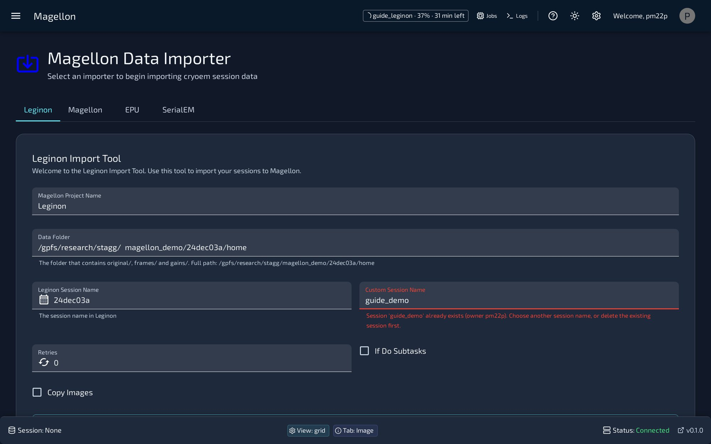

## Check the folder layout

<!-- widths: 0.18 0.82 -->
| Importer | What the folder must contain |
|---|---|
| Leginon | The session's data folder with **original/**, **frames/** and **gains/** directly inside it. If the session has a **home** folder, include it in the path, e.g. magellon_demo/24dec03a/home. |
| EPU | The EPU session folder (the one holding the grid-square folders and .xml metadata), with a **gains/** folder holding the gain file and, optionally, a **defects/** folder. |
| SerialEM | The SerialEM data folder (.mrc / .st images with their .mdoc files, optionally a .nav file), with gains as for EPU. |
| Magellon | A Magellon export: session.json plus home/original, home/frames and home/gains. |

# 5. Importing a session

Open **Import** from the menu. The four tabs are the four kinds of import: **Leginon**, **Magellon**, **EPU** and **SerialEM**.

## 5.1 Leginon

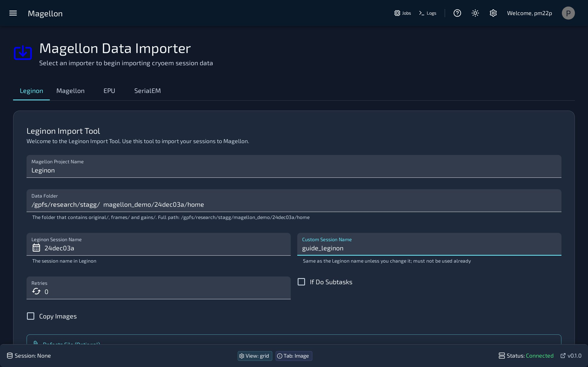

<!-- widths: 0.3 0.7 -->
| Field | What to enter |
|---|---|
| Magellon Project Name | The project the session belongs to. "Leginon" is fine if you don't use projects. |
| Data Folder | The path below /gpfs/research/stagg/ to the folder holding original/, frames/ and gains/, e.g. magellon_demo/24dec03a/home. The full path is shown under the field. |
| Leginon Session Name | The session's name in Leginon, e.g. 24dec03a. Magellon reads the session's images and their settings from the Leginon database by this name. |
| Custom Session Name | The name in Magellon. It copies the Leginon name until you change it. Change it if that name is taken, e.g. 24dec03a_run2. |
| Retries, If Do Subtasks, Copy Images | Leave as they are. |
| Defects File / Gains File | Optional uploads. Only needed if the data folder has no suitable gain file, or you want a defects file used. |

Click **Import**. The progress window opens (section 6).

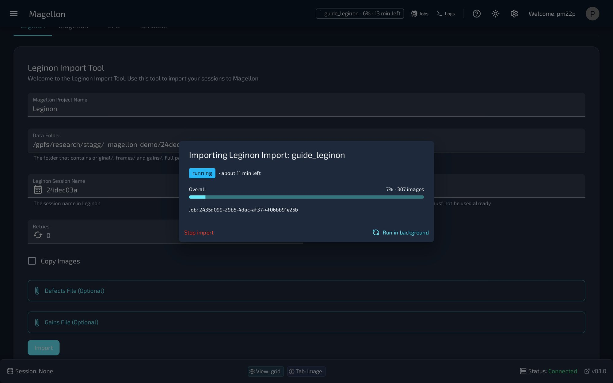

## 5.2 EPU

1. Open the **EPU** tab. The folder browser starts at the lab's research storage.
2. **Double-click** folders to open them until you are in the EPU session folder. The path fills in **EPU Directory Path**.
3. Type the **EPU Session Name** (the name in Magellon).
4. Check the default values (pixel size, voltage, spherical aberration, gain rotation and flip) for your data.
5. Click **Import EPU Data**.

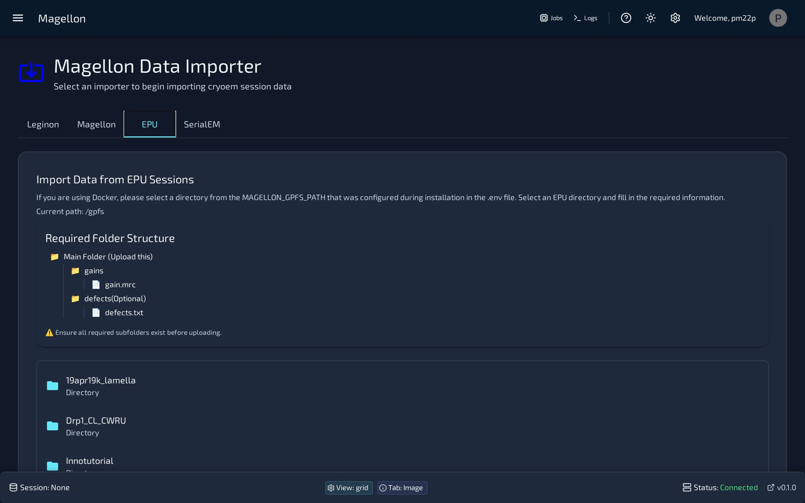

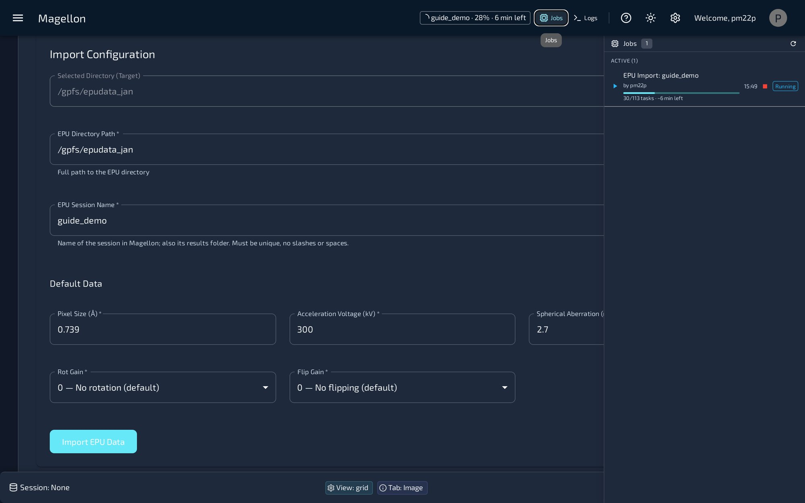

> **Important.** Choose the session folder itself, not a sub-folder such as **gains**. A folder with no EPU metadata is refused with a message saying so.

## 5.3 SerialEM

SerialEM imports work the same way as EPU: browse to the data folder, check the files it finds (.mrc, .st, .mdoc, .nav), enter a session name, choose single-particle or tomography data and the frame type, check the microscope values, and import.

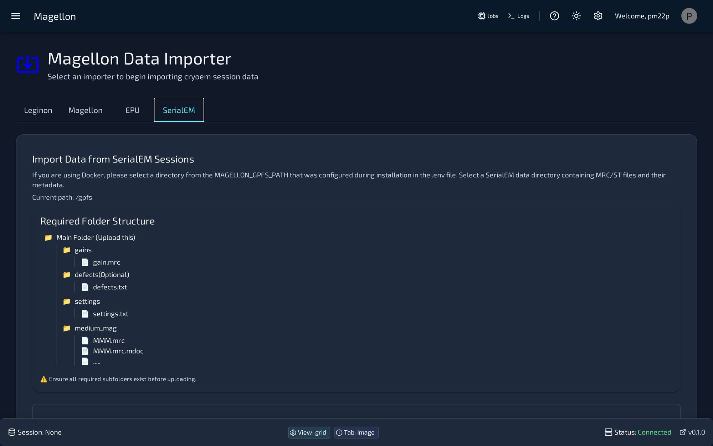

## 5.4 Magellon

The Magellon tab imports a session exported from another Magellon installation. Choose the folder holding session.json and its home folder.

# 6. The import queue and following progress

## 6.1 The queue

- Every import goes into a queue. Up to **4 imports** run at the same time.
- Turns are shared fairly: when a slot frees up, the person with the fewest imports running goes next, so one person's batch can't block everyone else.
- While an import waits, its window says *"Waiting for a free import slot: position N in the queue"*. You can withdraw it from there.
- Each import runs on its own, so one import failing never affects the others.

## 6.2 What happens during an import

1. **Preparing**: Magellon reads the session (Leginon database, or EPU/SerialEM metadata) and creates the session and its images. For big sessions this takes a few minutes.
2. **Pictures**: a PNG picture and an FFT are made for every image.
3. **CTF**: exposures are sent to the CTF plugin (images with a pixel size above 5 Å, such as atlas and grid overviews, are skipped).
4. **Motion correction**: exposures with movies are sent to MotionCor on the GPUs.
5. **Done**: when every image is finished, the job shows **Done**. If a few images failed, it is still Done, and the problems are listed.

As a guide: the EPU demo (113 images) took about 10 minutes and a Leginon session of 307 images about an hour and a quarter, depending on how busy the GPUs are.

## 6.3 The progress window

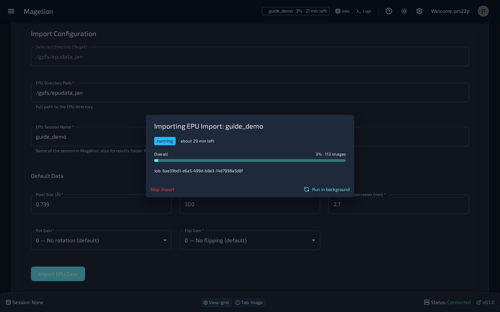

## 6.4 Running in the background: the top-bar chips

Click **Run in background** to keep working. A chip in the top bar shows each running import with its progress and time left. Click a chip to reopen its progress window. When more than three imports run, a "+N more" chip points you to the Jobs panel.

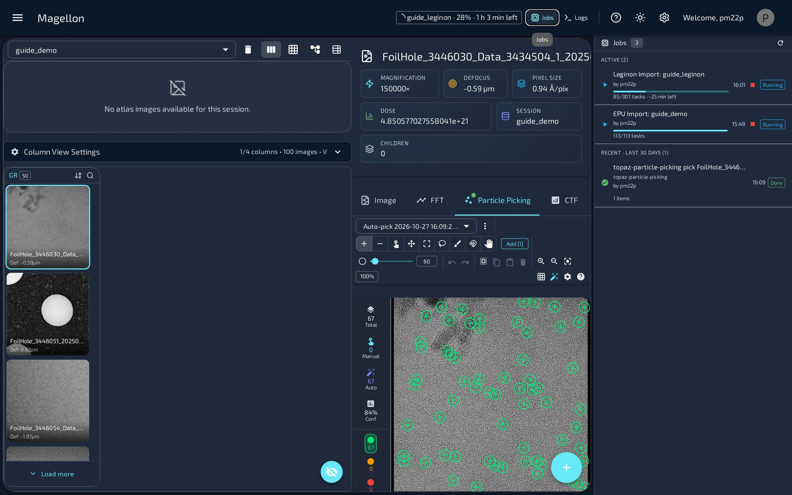

## 6.5 The Jobs panel

Click **Jobs** in the top bar. The panel lists everyone's jobs, with who started each one:

- **Active**: queued and running jobs, with tasks done, time left and a red stop button (owner and administrators only).
- **Recent - last 30 days**: finished jobs (Done, Failed, Cancelled). Failed jobs show the reason on the row. Finished imports have a bin icon to delete their session.

# 7. Viewing a session

Open **Images** and choose a session in the drop-down at the top left.

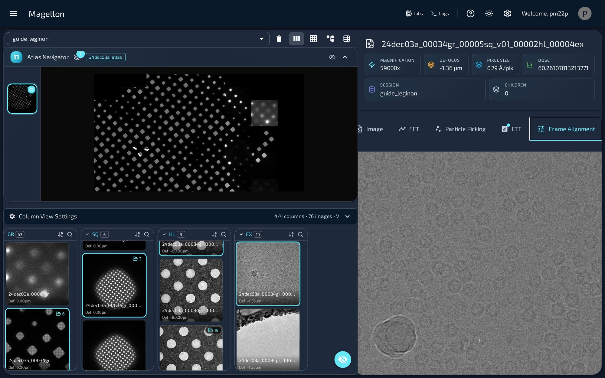

- **Atlas**: Leginon sessions show the grid atlas. Click a square to go to it.
- **Columns**: each column is one level (atlas, grid square, hole, exposure). Clicking an image shows its children in the next column.
- The buttons next to the drop-down switch between the column view and other layouts, and the bin icon deletes the session (section 9).
- Thumbnails show each image's defocus. Use the sort and search icons above a column.

## The image panel

Click an image to open it on the right. The header shows magnification, defocus, pixel size, dose, session and how many images sit below it. The tabs:

<!-- widths: 0.22 0.78 -->
| Tab | Shows |
|---|---|
| Image | The image itself, with zoom and pan. |
| FFT | Its Fourier transform. |
| Particle Picking | Picking tools and saved picks (section 8). |
| CTF | Defocus 1 and 2, astigmatism angle, estimated resolution, the power spectrum and fit plots. Export downloads the values. |
| Frame Alignment | MotionCor results for exposures with movies: the drift of the frames. |
| Metadata | Every value recorded for the image. |

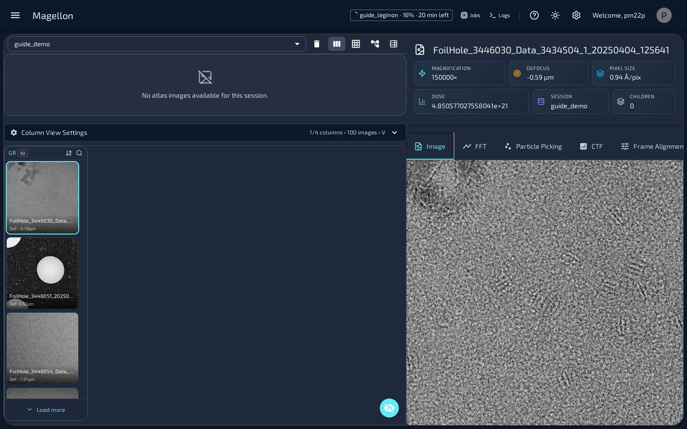

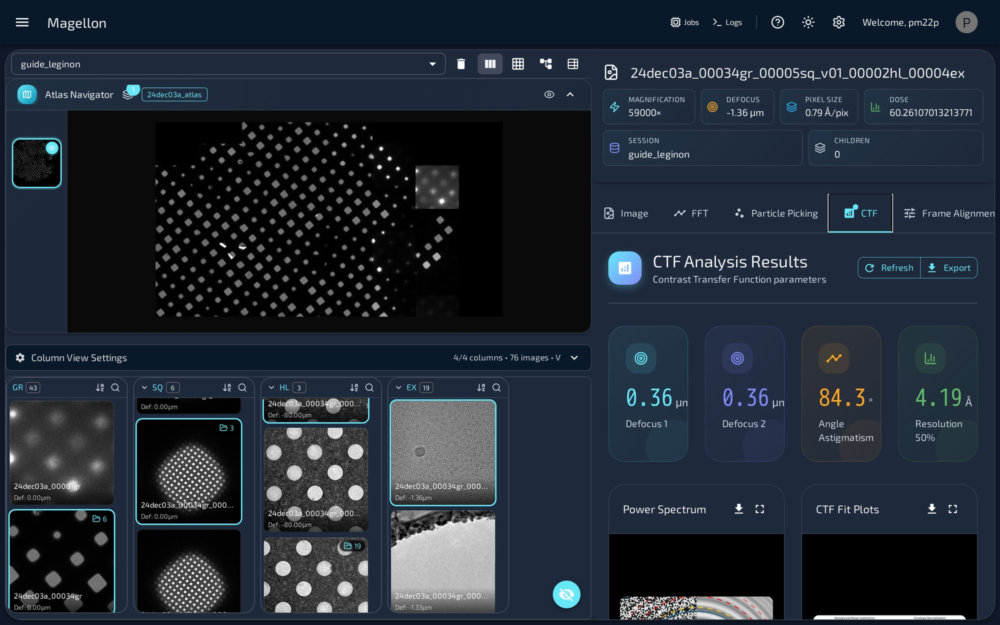

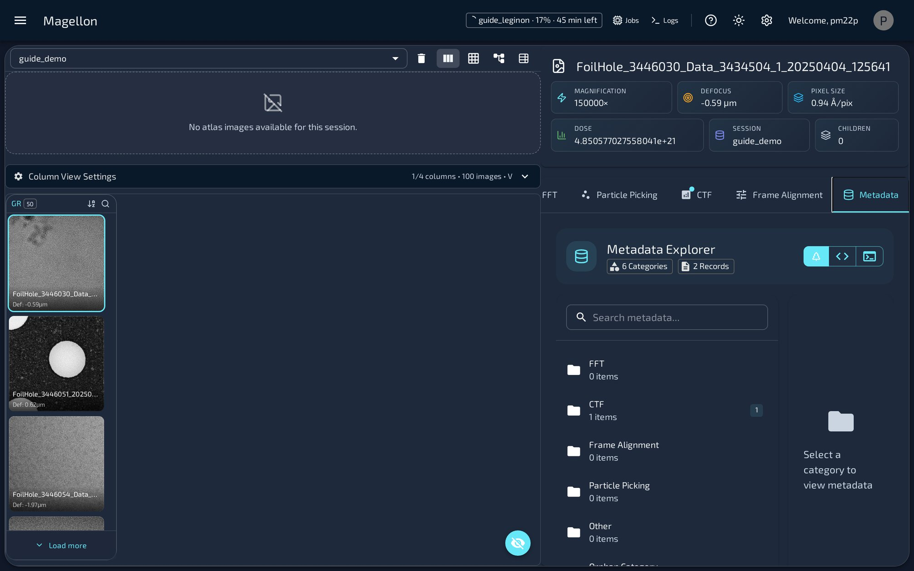

> **Tip.** Images still being processed can show "image not found" or an empty CTF tab for a while. Wait for the import to finish before judging the results.

# 8. Particle picking

Open an exposure and the **Particle Picking** tab. Picks are kept in **picking records**: choose one in the drop-down at the top left of the toolbar, or make a new one from the menu next to it.

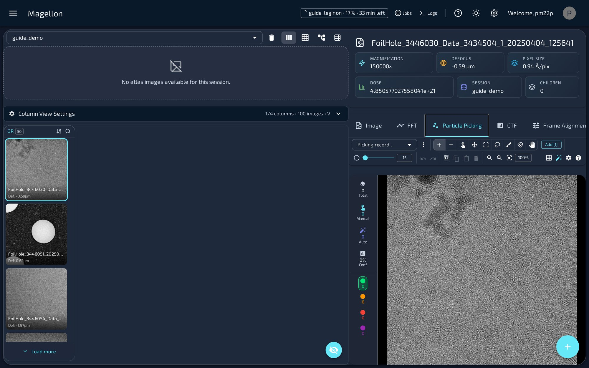

## Picking by hand

<!-- widths: 0.34 0.66 -->
| Tool (key) | Use |
|---|---|
| Add (1) | Click on a particle to add a pick. |
| Remove (2) | Click a pick to remove it. |
| Select (3), Move (4) | Select picks, then drag them. |
| Box Select (5), Brush (6), Lasso (L) | Select many picks at once. |
| Particle radius | The slider and box set the circle size. |
| Undo, Redo, Copy, Paste, Delete | As usual. |
| Grid (G), Zoom, Pan | Help with placing picks. |
| Save (Ctrl+S) | Saves the picks in the record. |
| Help (H) | Lists all the shortcuts. |

## Automatic picking

1. Click the **Settings** gear in the picking toolbar. The **Algorithm Settings** drawer opens.
2. Choose the algorithm: **Topaz Particle Picking**, or the template picker (needs template files).
3. Adjust the settings (for Topaz: model, score threshold, exclusion radius, scale).
4. **Preview & tune (no save)** tries the settings on this image without saving.
5. **Save current image** picks this image and saves the result as a new record. **Run batch...** picks many images.
6. Check the result, then click **Accept** to keep it or **Discard** to remove it.

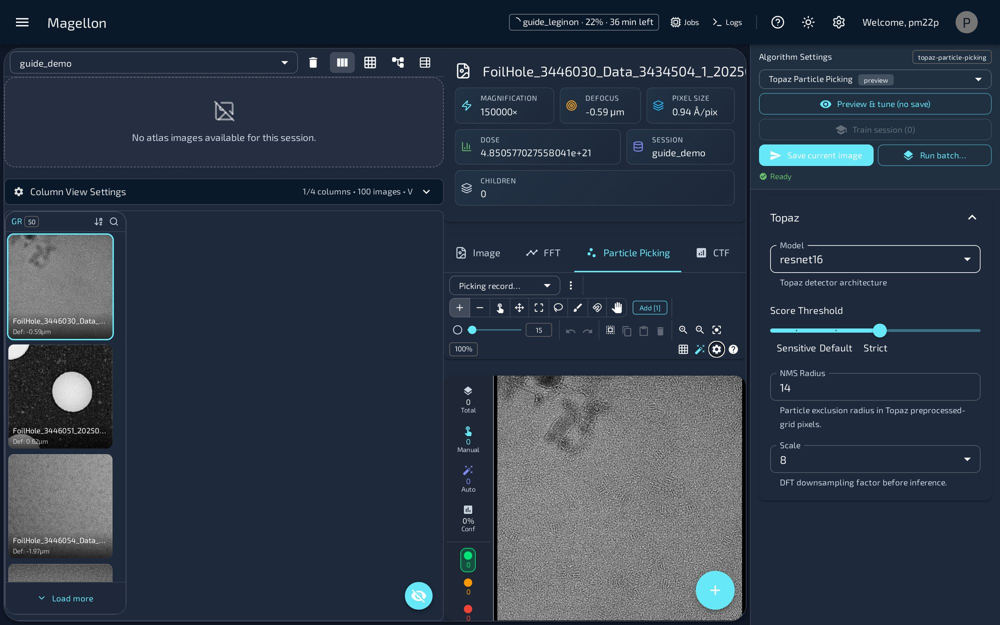

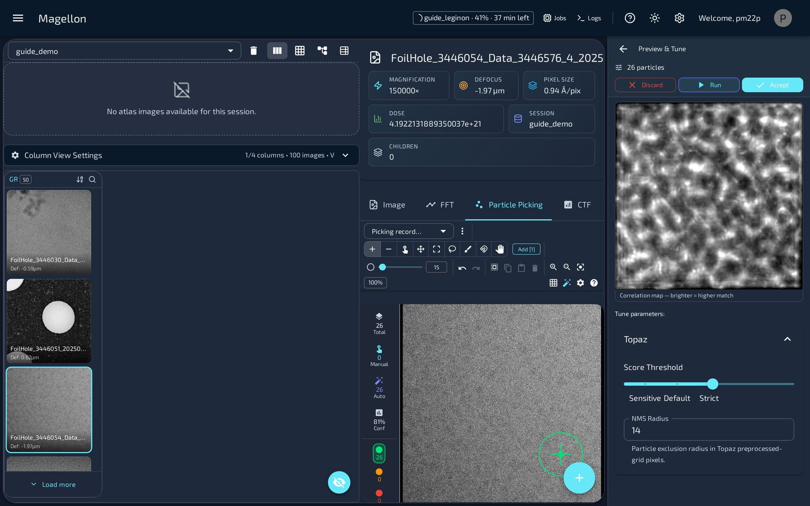

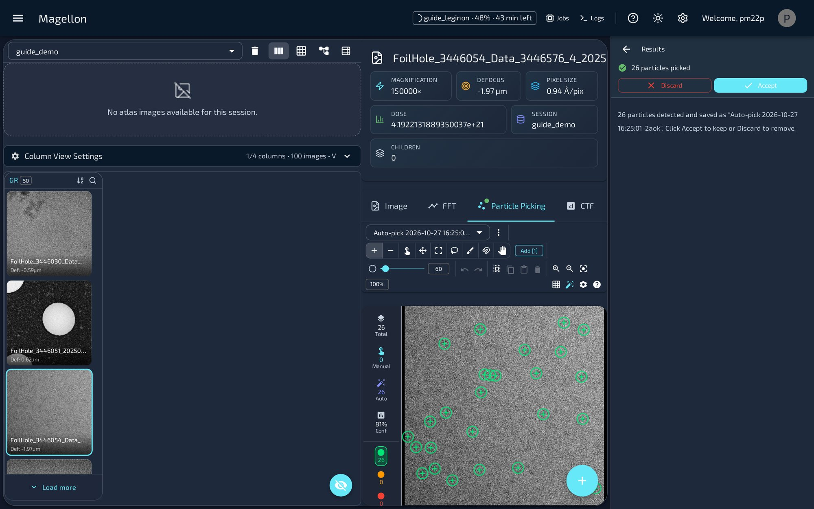

Each automatic pick also appears in the Jobs panel. A pick that a plugin never starts is marked failed after an hour with a message saying so; run it again, and tell an administrator if it happens twice.

## Testing MotionCor or CTF on a single file

To try settings on one movie or micrograph without importing a session, open **Jobs** from the menu (Run Processing Jobs) and choose the pipeline: **Frame Alignment (MotionCor2)** or **CTF Estimation (CTFFIND4)**. Members and Administrators can use it.

1. Upload the file: a movie and its gain file for MotionCor (optionally a defects file), or a micrograph for CTF.
2. Open **Advanced Parameters** and set at least the real **pixel size** (it starts at 1 Å) and voltage for your data.
3. Click **Run Motion Correction** or **Run CTF Estimation**. The result appears on the same page when it is done - usually within a minute or two.

- **Nothing is saved**: no session, no database record. The files live in a scratch folder and are removed by the nightly clean-up, so download anything you want to keep.
- **Tests go first**: a test doesn't wait behind imports. It takes the next free turn on a GPU, so at most it waits for the one image already being processed.

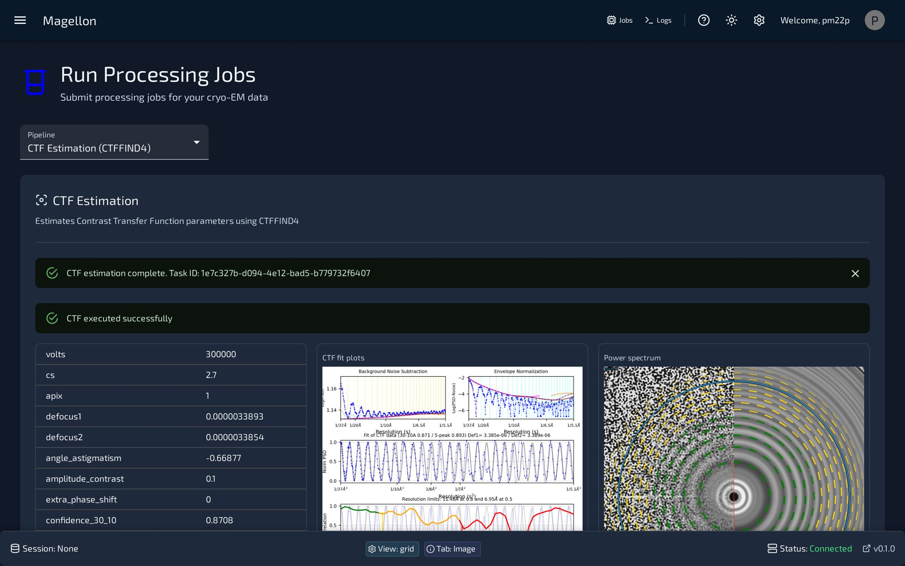

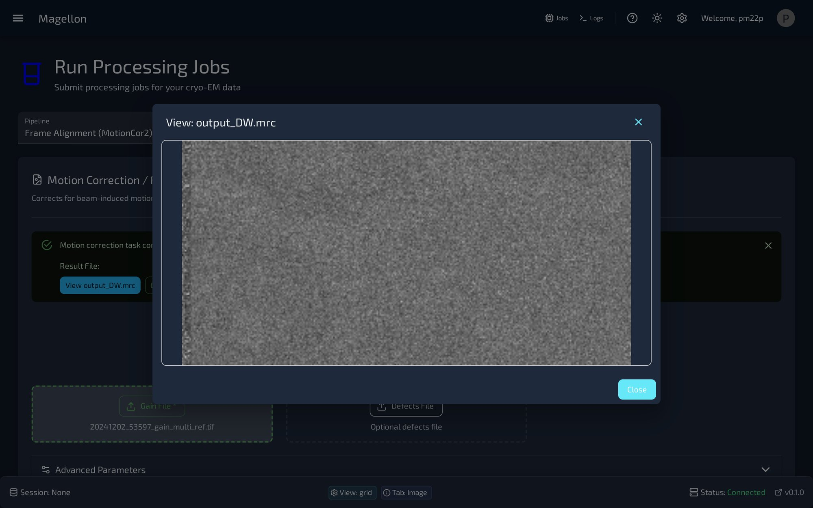

# 9. Stopping imports and deleting sessions

## Stopping an import

Stop an import from its progress window (**Stop import**) or from the red stop button in the Jobs panel. You are asked to confirm.

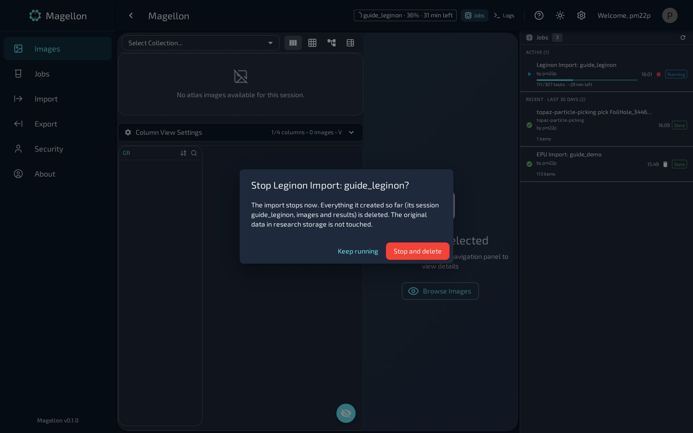

- A **queued** import is simply withdrawn.
- A **running** import stops within seconds. Its waiting CTF and MotionCor work is cancelled and **everything it created is deleted**: the session, its images, results and folders.
- A stopped import can't be resumed. To try again, import the session again.
- Stopping never touches the original data, nor another session made from the same data.

## Deleting a session

Delete a session with the bin icon next to the session drop-down on the Images page, or the bin icon on a finished import in the Jobs panel.

1. Click the bin icon. A confirmation window opens.
2. Type the session name exactly as shown (without the quotes). The Delete button only becomes active when it matches.
3. Click **Delete**. A notification shows "Deleting..." and then "Session ... deleted".

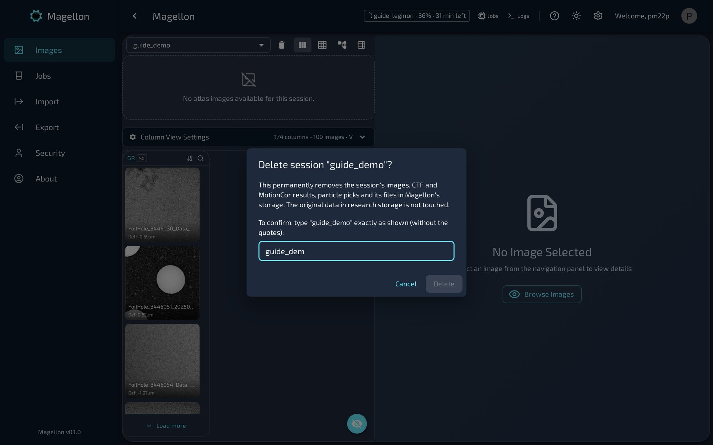

> **Important.** Deleting removes the session's records, pictures, results and particle picks from Magellon for good. The original data in research storage is not touched, so the session can be imported again. A session can't be deleted while its import is running: stop the import instead.

# 10. Automatic clean-up

Magellon tidies up after itself. You don't need to do anything for these:

<!-- widths: 0.2 0.27 0.53 -->
| What | When | What happens |
|---|---|---|
| Scratch folders (jobs) | Every night at 06:00 UTC (2 am Eastern in summer, 1 am in winter) | Plugin scratch folders of finished work, unchanged for 2 hours, are removed. Your results are already in the session folder and are not affected. Folders of running work are always kept. |
| Stuck plugin jobs | Every minute | A particle pick still waiting after an hour, while its plugin finished nothing in that hour, is marked failed with the reason ("Never started"). Run it again. |
| Stalled imports | Every minute | An import whose worker stopped responding for 5 minutes is marked failed, so it doesn't look "running" forever. |
| Jobs panel history | Always | Finished jobs older than 30 days are left out of the panel. |

What is **not** cleaned automatically: your sessions. Each session stays until its owner or an administrator deletes it (section 9).

# 11. Exporting

The **Export** page writes a RELION star file for a session, with the CTF values of each image, ready for processing in RELION.

1. Choose the **Session**.
2. Enter the **Output Directory** where the star file should be written.
3. Optionally filter by magnification (0 = all) and keep **Filter for images with movies** on to export only exposures with movies.
4. Choose how the image files are provided (**Symlink** is quickest and uses no space).
5. Click **Generate RELION Star File**.

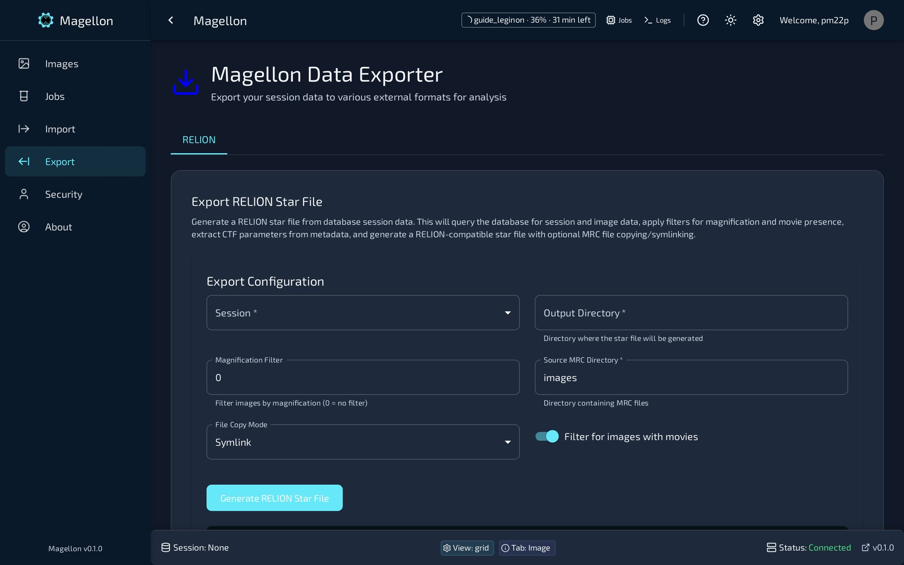

# 12. Troubleshooting

<!-- widths: 0.4 0.6 -->
| You see | What it means and what to do |
|---|---|
| "Name already taken" while typing a session name | Another session or import uses it. Choose another name, or delete the old session if it is yours. |
| "No EPU metadata (.xml files) found" | You chose the wrong folder (often gains). Choose the EPU session folder. |
| Leginon: original/, frames/ or gains/ not found | The data folder path is wrong. It must point at the folder holding those three folders; include home if the data has it. |
| "Waiting for a free import slot" | 4 imports are already running. Yours starts automatically. |
| "Preparing: reading the session" for several minutes | Normal for large sessions. |
| "Image not found" or no CTF while importing | The image is still being processed. Wait for Done. |
| "The import worker was restarted while this import was running" | The server was restarted. Import the session again. |
| A pick says "Never started" | Run it again. If it happens again, tell an administrator. |
| The Import page is missing | Your account is a Viewer. Ask an administrator. |
| No Stop or Delete button | Only the owner and administrators can stop an import or delete a session. |

# 13. Your account: changing your password

Every user can change their own password. Open **Security** from the menu; the **My Profile** tab shows your account.

1. Click **Change Password**.
2. Enter your **Current Password**.
3. Enter the **New Password** twice. It needs at least 8 characters, with an uppercase letter, a lowercase letter, a number and a special character.
4. Click **Change Password**. Use the new password the next time you log in.

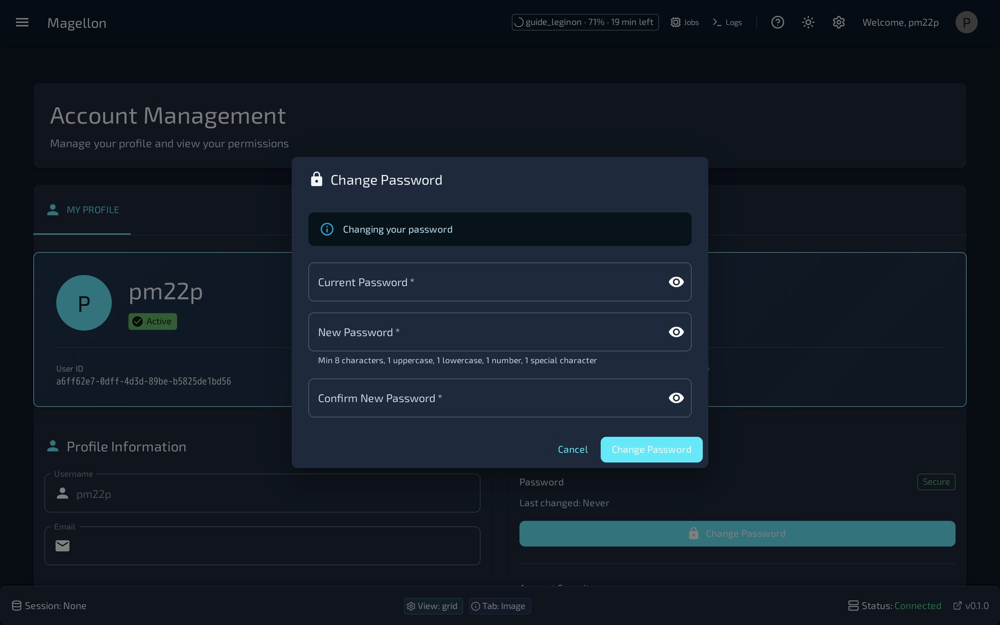

> **Tip.** Forgot your password? Ask an administrator to reset it (section 14.2). An administrator can also make you choose a new one the next time you log in.

# 14. For administrators

Open **Security** from the menu. Administrators see six tabs: My Profile, User Management, Role Management, Permissions, Permission Checker and Session Access.

## 14.1 Adding a user

1. Open **User Management** and click **Add User**.
2. Enter the **Username**, a first **Password** and optionally an **Email**, then click **Create**.
3. Give the new user a role (14.3). Until then they can log in but see nothing.

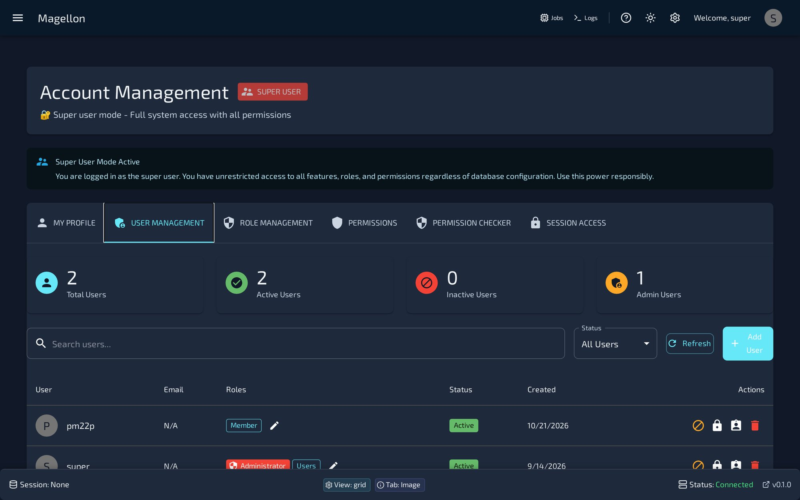

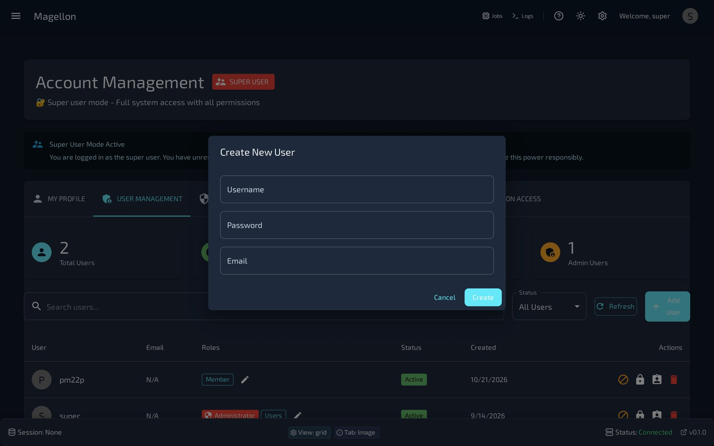

The icons at the end of each user's row are, from left to right:

<!-- widths: 0.25 0.75 -->
| Icon | Does |
|---|---|
| Circle with a line | Deactivate the account (the user can no longer log in) or activate it again. |
| Padlock | Reset the user's password (14.2). |
| Badge | Assign roles (14.3). |
| Red bin | Delete the account (asks for confirmation). Prefer deactivating if the user may come back. |

## 14.2 Resetting a password

Click the padlock on the user's row. As an administrator you set a new password without knowing the old one. Tick **Require password change on next login** to make the user choose their own.

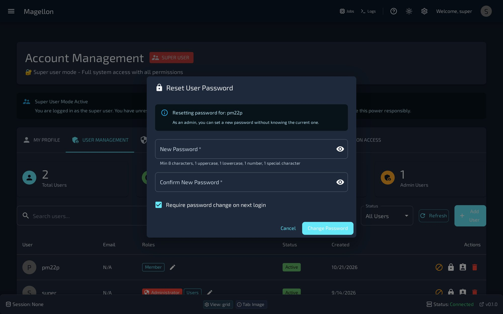

## 14.3 Giving someone a role

Click the badge icon (or the pencil next to the user's roles). Click a role to add it or remove it; the change applies **immediately**, even if the user is logged in. Then click **Done**.

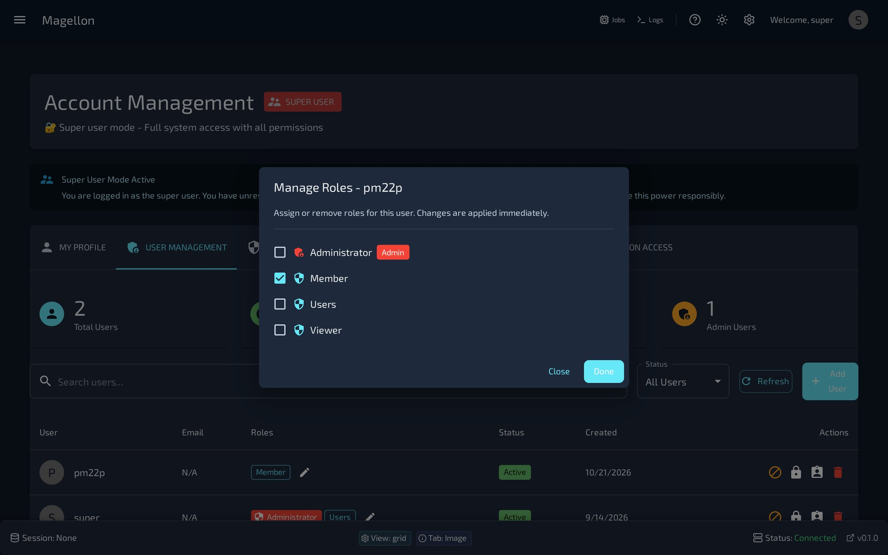

<!-- widths: 0.2 0.8 -->
| Role | Give it to |
|---|---|
| Viewer | People who only look at sessions and results. |
| Member | Lab members who import and process their own data. The usual choice. |
| Administrator | The people who run Magellon: manage users, delete any session, see the admin pages. |
| Users | Built-in base role (your own profile only). Not needed for lab members. |

## 14.4 Roles and their permissions

**Role Management** lists the roles with how many users have each. **Create Role** makes a new role (a name, and whether it is administrative). **Manage** shows a role's permissions; the pencil renames it and the bin deletes it.

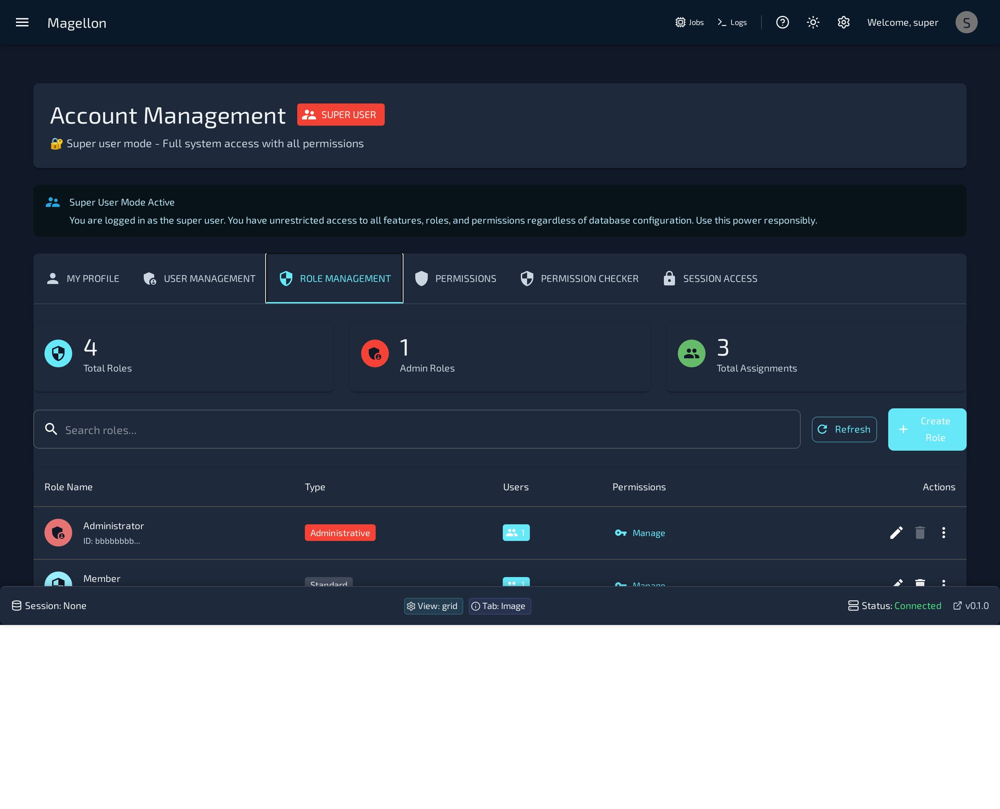

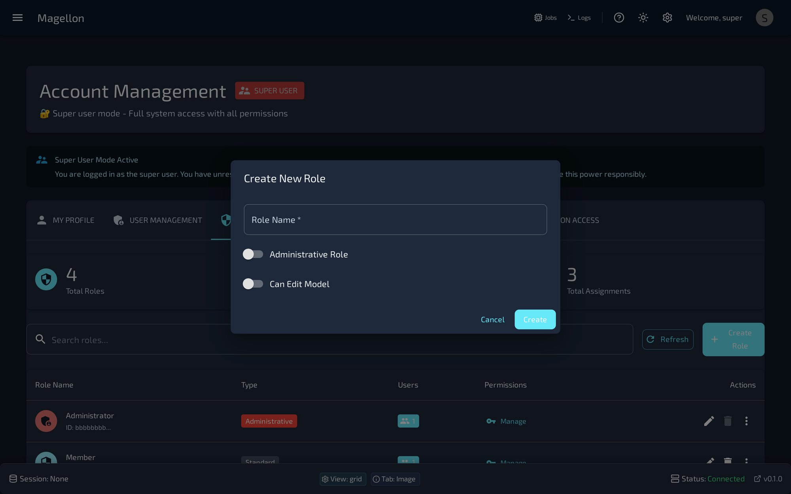

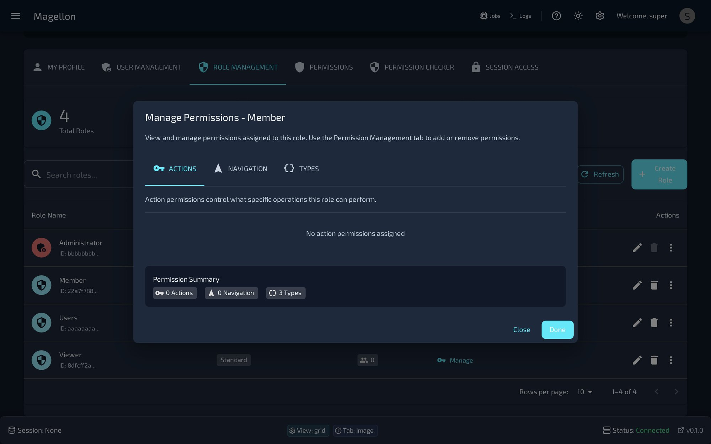

Permissions are edited on the **Permissions** tab: choose the role, then the kind of permission:

<!-- widths: 0.27 0.73 -->
| Kind | Controls |
|---|---|
| Type permissions | What the role can do with each kind of data - sessions, images, atlases - (read, write, create, delete, navigate). These decide what Magellon lets a role do. |
| Object permissions | The same, limited to particular records that match a condition. |
| Action permissions | Specific operations, such as creating a session. |
| Navigation permissions | Which menu items the role sees. |

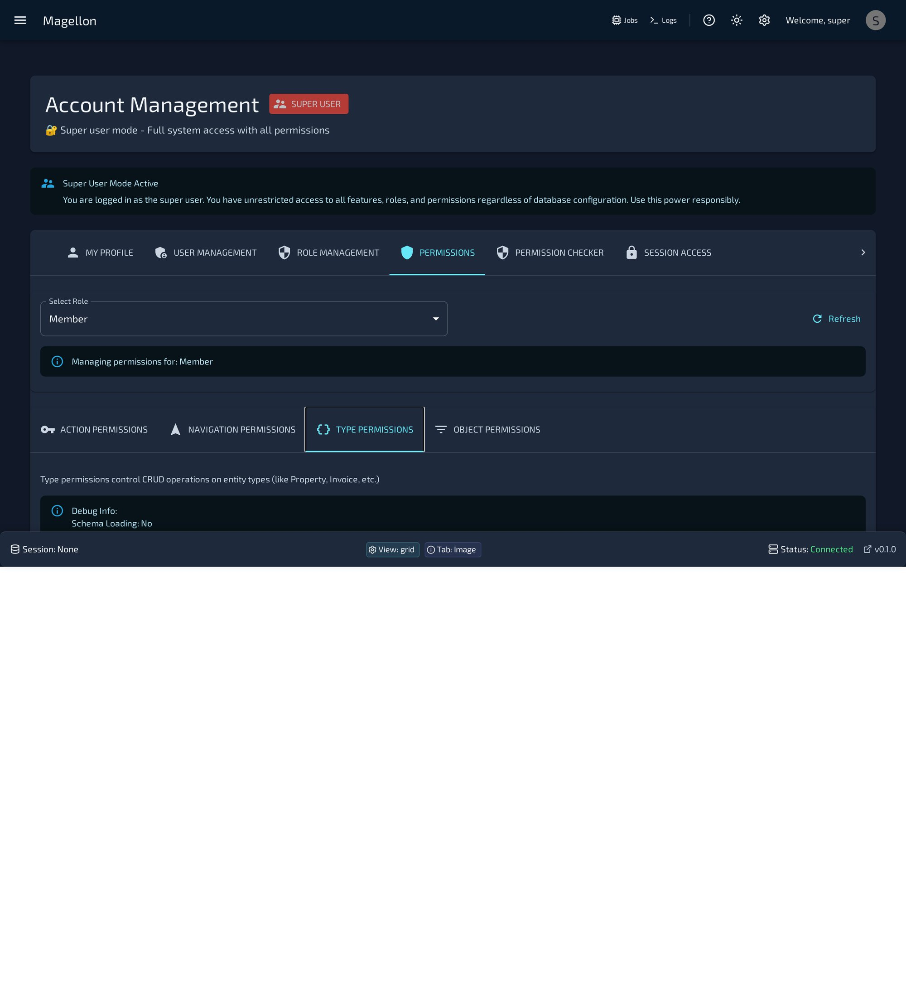

> **Important.** Magellon's built-in roles already carry the right permissions: Viewer reads sessions and images, Member also creates (imports) sessions, Administrator can do everything. Change them, or build new roles, only if you need something different - and check the result with the Permission Checker.

## 14.5 Checking what someone can do

**Permission Checker**: choose a user, a kind of permission and a resource, and click **Check Permission** to see whether that user is allowed.

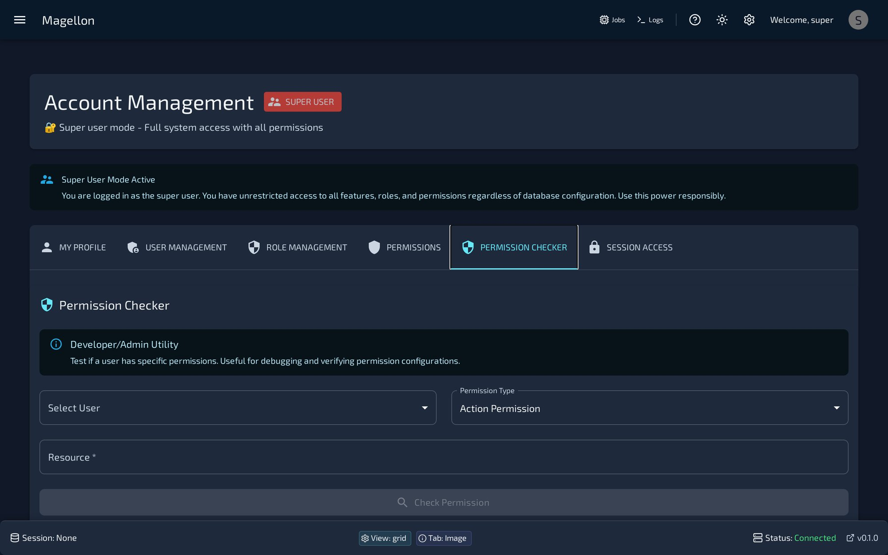

## 14.6 Session Access

**Session Access** gives or removes one user's access to one particular session - for example to let a Viewer from another lab see only their own session. Choose the session, then the user.

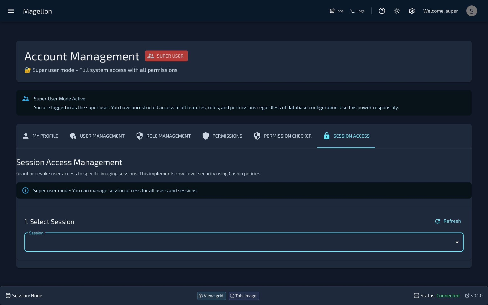

## 14.7 Plugins and health

- **Plugins** lists the processing plugins (CTF, MotionCor, Topaz, template picker, ...) and whether each is running.
- **Tools - Pipeline Health** shows the processing queues and workers.
- **Tools - Ops Event Log** lists operational events.
- Administrators can stop any import and delete any session.

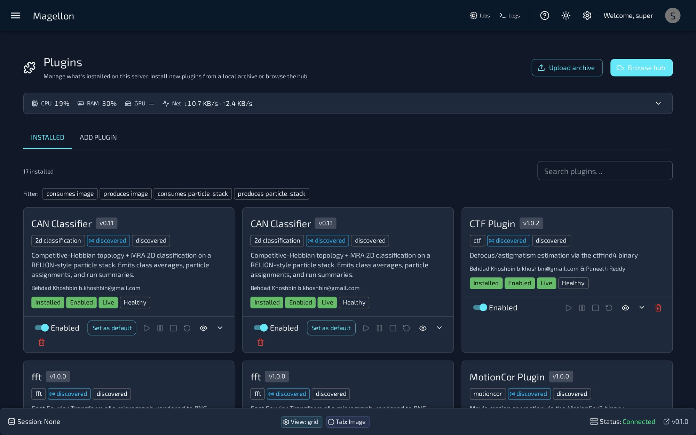

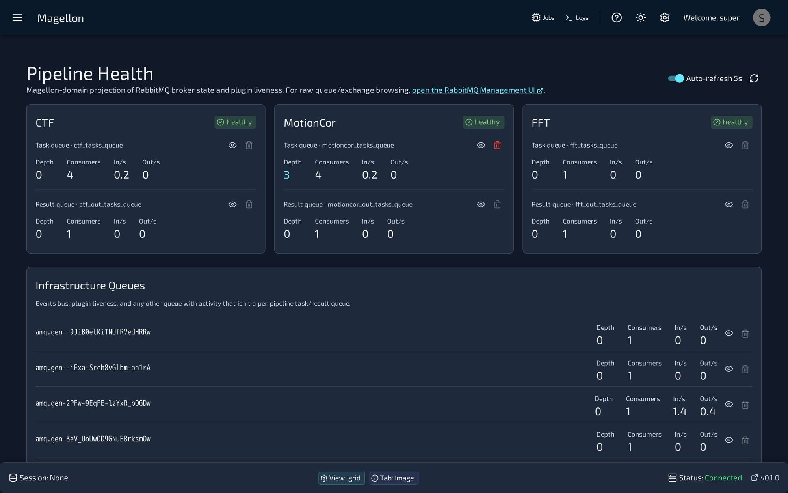

# Quick reference

<!-- widths: 0.4 0.6 -->
| To... | Go to |
|---|---|
| Import a session | Menu - Import - Leginon / EPU / SerialEM tab |
| See an import's progress | Its chip in the top bar, or Jobs |
| Keep working while it imports | Run in background |
| See everyone's jobs | Jobs (top bar) |
| Browse a session | Menu - Images - choose the session |
| Check CTF / motion correction | Images - click an exposure - CTF / Frame Alignment tab |
| Pick particles | Images - click an exposure - Particle Picking |
| Stop an import | Progress window - Stop import, or the red stop button in Jobs |
| Delete a session | Images - bin icon next to the session, or bin icon in Jobs |
| Export results | Menu - Export |
| Change your password | Security - My Profile - Change Password |
| Get a role changed | Ask an administrator (Security page) |

